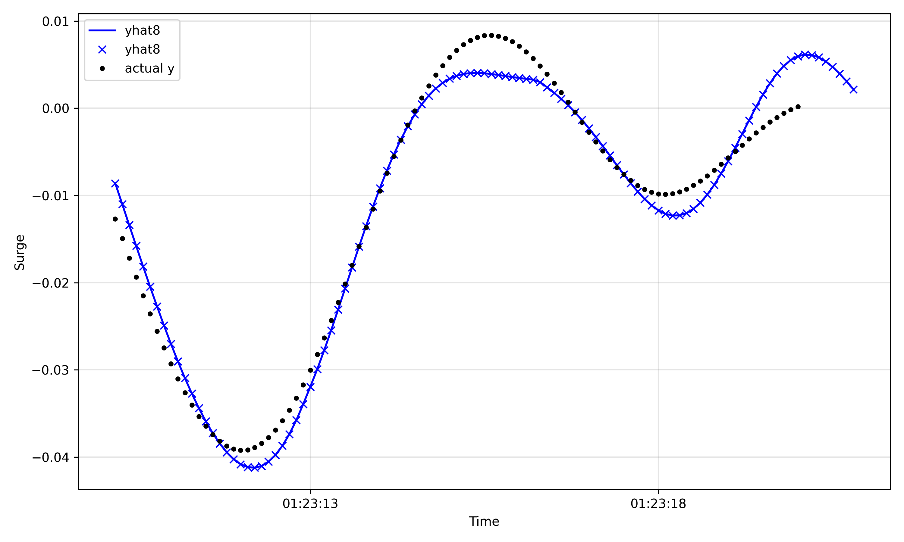

# Neural-Prophet: 부유체 6자유도 운동 시계열 예측

[NeuralProphet](https://github.com/ourownstory/neural_prophet)으로 부유체의 6자유도 운동(Surge, Sway, Heave, Roll, Pitch, Yaw) 시계열을 학습하고, **과거 16초를 보고 미래 16초의 Surge를 예측**하는 실험 코드입니다.

## 개요

- **입력 데이터**: `.mot` 형식의 운동 시계열 (`Time, Surge, Sway, Heave, Roll, Pitch, Yaw`), 샘플링 간격 0.1초
- **예측 대상**: `Surge` (`y`)
- **보조 입력**: `Sway, Heave, Roll, Pitch, Yaw`를 lagged regressor로 사용
- **학습/검증 분할**: 8 : 2

### 모델 설정 (`train.py`)

| 항목 | 값 |
| --- | --- |
| `n_lags` | 160 (과거 16초) |
| `n_forecasts` | 160 (미래 16초) |
| `ar_layers` | `[32, 16]` |
| `lagged_reg_layers` | `[16, 8]` |
| `batch_size` | 64 |
| 계절성 | 연·주·일 계절성 끔, 160스텝(16초) 주기 계절성 추가 (`fourier_order=3`) |

## 파일 구성

| 파일 | 설명 |
| --- | --- |
| `train.py` | 데이터 전처리, 모델 정의·학습, 모델 저장 (`./model/neupModel_nforecasts160.pt`) |
| `forecast.py` | 저장된 모델을 불러와 예측, 예측 그래프·잔차 그래프 저장, `yhat1`~`yhat160`별 MAE 출력 |
| `train.log`, `forecast.log` | 학습·예측 실행 로그 |
| `forecast_*.png` | 예측 구간 그래프 (`yhat8`, `yhat160` 기준, 시작·끝 구간) |
| `residuals_yhat1.png`, `residuals_yhat160.png` | 1스텝·160스텝 예측의 잔차 |
| `result_with_wave.png`, `result_without_wave.png` | 6개 변수의 실제값 vs 예측값 비교 |

## 실행 방법

```bash
pip install neuralprophet torch pandas matplotlib

# 1. 학습
python train.py

# 2. 예측 및 평가
python forecast.py
```

데이터는 `./time_series/orgin_dataset/LIN_001_IRR_MOT.mot`, 모델 저장 폴더는 `./model/`을 기준으로 합니다. 두 경로 모두 저장소에 포함돼 있지 않으니 직접 준비해야 합니다.

> `forecast.py`는 전처리된 데이터프레임을 `t1` 모듈(`t1.df`)에서 가져오는데, `t1.py`는 저장소에 없습니다. `train.py`와 같은 방식으로 전처리한 `df`를 담은 `t1.py`를 만들어 두거나, 해당 부분을 `from train import df`로 바꿔서 실행하세요.

## 결과

`forecast.log` 기준, 예측 스텝별 평균 절대 오차(MAE)입니다.

| 예측 스텝 | MAE |
| --- | --- |
| `yhat1` (0.1초 후) | 0.00643 |
| `yhat8` (0.8초 후, 최저) | 0.00319 |
| `yhat20` (2초 후) | 0.00810 |
| `yhat160` (16초 후) | 0.03964 |

0.8초 앞 예측의 오차가 가장 작고, 예측 거리가 멀어질수록 오차가 꾸준히 커집니다.


