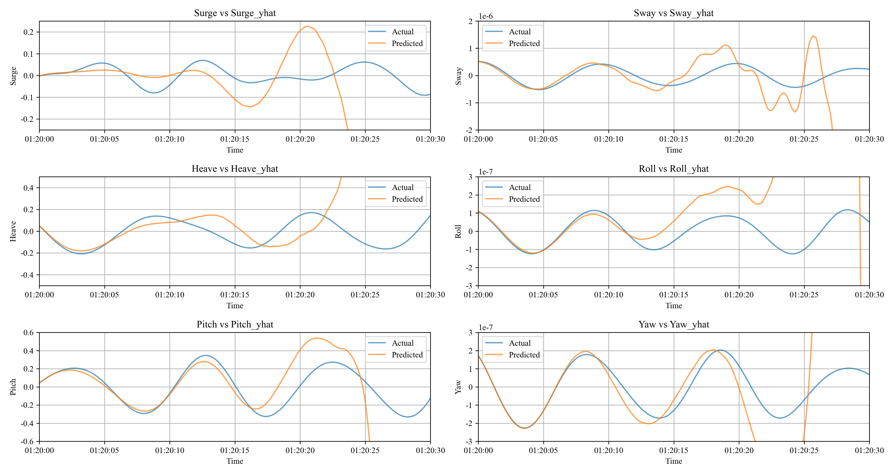
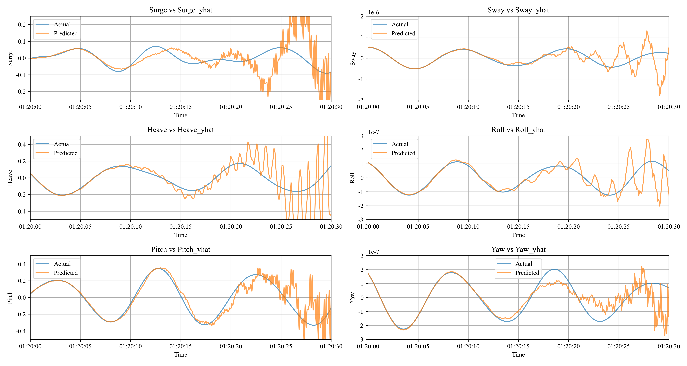

# Neural-Prophet: 선박 6자유도 운동 시계열 예측

[NeuralProphet](https://github.com/ourownstory/neural_prophet)으로 부유체의 6자유도 운동(Surge, Sway, Heave, Roll, Pitch, Yaw) 시계열을 자유도별로 각각 학습해, **과거 16초를 보고 미래 16초를 예측**하는 실험 코드입니다. 레포의 `train.py`·`forecast.py`는 Surge 모델 기준이며, 나머지 5개 자유도는 각각 따로 학습했습니다.

## 개요

- **입력 데이터**: `.mot` 형식의 운동 시계열 (`Time, Surge, Sway, Heave, Roll, Pitch, Yaw`), 샘플링 간격 0.1초
- **예측 대상**: 자유도별 개별 모델 (코드 예시는 `Surge`를 `y`로 사용)
- **보조 입력**: 예측 대상을 뺀 나머지 자유도를 lagged regressor로 사용 (Surge 모델은 `Sway, Heave, Roll, Pitch, Yaw`)
- **학습/검증 분할**: 8 : 2

### 모델 설정 (`train.py`)

| 항목 | 값 |
| --- | --- |
| `n_lags` | 160 (과거 16초) |
| `n_forecasts` | 160 (미래 16초) |
| `ar_layers` | `[32, 16]` |
| `lagged_reg_layers` | `[16, 8]` |
| `batch_size` | 64 |
| 계절성 | 연·주·일 계절성 끔, 160스텝(16초) 주기 계절성 추가 (`fourier_order=3`) |

## 파일 구성

| 파일 | 설명 |
| --- | --- |
| `train.py` | 데이터 전처리, 모델 정의·학습, 모델 저장 (`./model/neupModel_nforecasts160.pt`) |
| `forecast.py` | 저장된 모델을 불러와 예측, 예측 그래프·잔차 그래프 저장, `yhat1`~`yhat160`별 MAE 출력 |
| `train.log`, `forecast.log` | 학습·예측 실행 로그 |
| `forecast_*.png` | 예측 구간 그래프 (`yhat8`, `yhat160` 기준, 시작·끝 구간) |
| `residuals_yhat1.png`, `residuals_yhat160.png` | 1스텝·160스텝 예측의 잔차 |
| `result_with_wave.png`, `result_without_wave.png` | 6개 변수의 실제값 vs 예측값 비교 |

## 실행 방법

```bash
pip install neuralprophet torch pandas matplotlib

# 1. 학습
python train.py

# 2. 예측 및 평가
python forecast.py
```

## 결과

`forecast.log` 기준, 예측 스텝별 평균 절대 오차(MAE)입니다.

| 예측 스텝 | MAE |
| --- | --- |
| `yhat1` (0.1초 후) | 0.00643 |
| `yhat8` (0.8초 후, 최저) | 0.00319 |
| `yhat20` (2초 후) | 0.00810 |
| `yhat160` (16초 후) | 0.03964 |

0.8초 앞 예측의 오차가 가장 작고, 예측 거리가 멀어질수록 오차가 꾸준히 커집니다.


## 파도 데이터 추가 전후 비교

운동 데이터만으로 학습한 모델과, 파도 데이터를 추가로 학습한 모델의 6개 자유도 예측을 같은 구간(30초)에서 비교했습니다. 각 그림은 자유도별로 따로 학습한 6개 모델의 결과를 한 장으로 합친 것이고, 아래 초 단위는 그래프를 보고 읽은 값입니다.

| 파도 데이터 없음 | 파도 데이터 추가 |
| --- | --- |
|  |  |

- **파도 데이터 없음**: 약 10초 이후부터 예측값이 실제값에서 벗어나고, 이후 크게 발산합니다.
- **파도 데이터 추가**: 실제값을 따라가는 구간이 약 15초까지 늘어났습니다. 그 뒤로는 예측값이 흔들리지만, 실제값의 흐름에서 크게 벗어나지는 않습니다.

> 파도 데이터를 학습에 넣은 코드는 이 레포에 포함되어 있지 않습니다. `train.py`는 운동 데이터만 사용하는 버전입니다.
